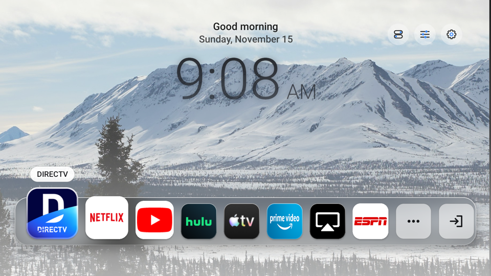
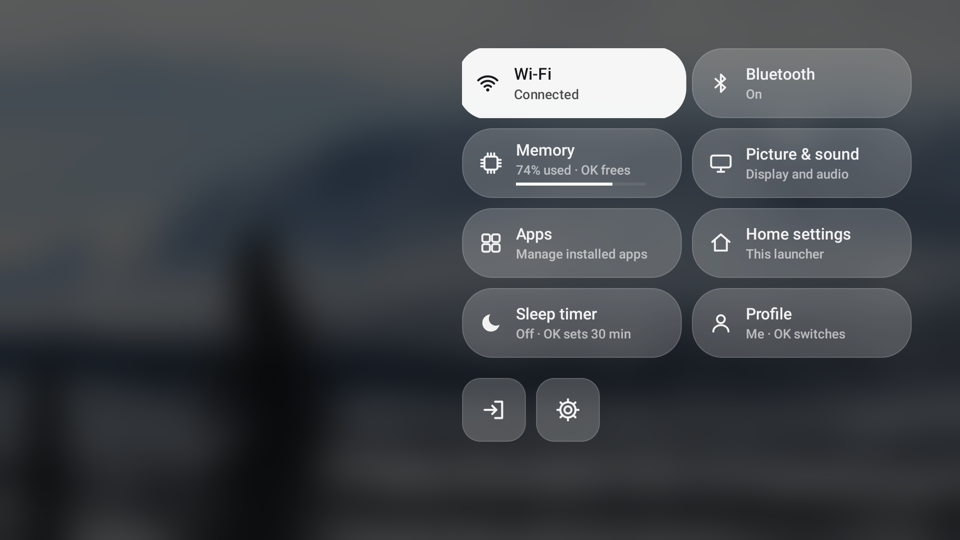
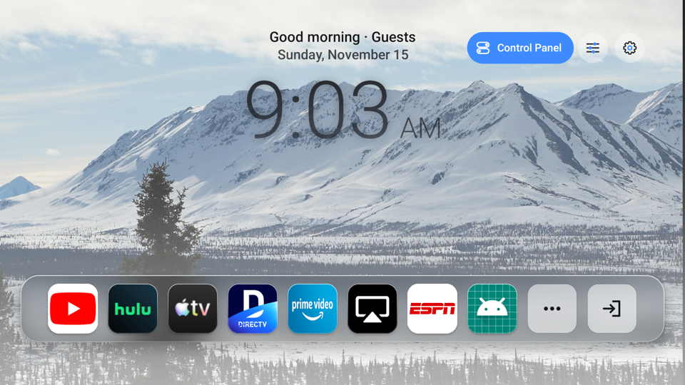

# glass-tv-launcher

**A clean, ad-free frosted-glass home screen for Amazon Fire TV and Fire TV smart TVs.**
A big clock, your apps in a glass dock, no sponsored rows, no auto-playing trailers.

<p align="center">
  
</p>

glass-tv-launcher is a fork of the open-source [dumbtv](https://github.com/humblemuzzu/dumbtv)
launcher (MIT), with a glass look inspired by tvOS and macOS. It uses no internet permission and no
advertising ID, and it leaves your apps, HDMI inputs and casting alone. Amazon's own launcher stays
installed and can be brought back at any time.

## Features

- **Glass dock.** App icons in a frosted dock that magnifies the focused app, with a ••• folder for
  the apps that do not fit (6, 8, 10 or all).
- **Big glass clock and greeting** (Good morning, Good evening…), lit from above like iOS.
- **Frosted tiles that read the wallpaper.** Text and glass switch between light and dark ink
  depending on how bright the picture is behind them.
- **Focus effects and themes:** colour fade, halo, blur and spotlight behind the focused app.
- **Control Panel** with Wi-Fi, Bluetooth, memory (free it with one press), picture and sound,
  inputs and settings.
- **Sleep timer.** Turns the TV off after 30, 60, 90 or 120 minutes.
- **Profiles: Me, Guests and Kids.** Each has its own apps in the dock and its own order.
- **Live TV / cable tile** that resumes the TV's built-in tuner on the last channel, with the guide
  and channel up/down working.
- **Remembers where you were.** The cursor comes back to the app you last opened, even after a
  restart.
- **Two-pane settings** (layout, tile style, wallpaper, clock, dock size, focus effect…), stored in a
  plain text file you can back up.
- **Crash recovery.** If the launcher ever stops, it reopens itself instead of leaving you on
  Amazon's home screen.

<p align="center">
  
  
</p>

## Install

You need a computer with [adb](https://developer.android.com/tools/releases/platform-tools) and
the TV on the same network with **Settings › My Fire TV › Developer options › ADB debugging** on.

```bash
git clone https://github.com/schavan78/glass-tv-launcher.git
cd glass-tv-launcher
adb connect <your-tv-ip>:5555
./launcher/install.sh
```

`install.sh` downloads the APK from this repo's
[latest release](https://github.com/schavan78/glass-tv-launcher/releases/latest), checks its
SHA-256, installs it, and hands it the Home button. `./launcher/install.sh --build` builds from
source instead, and `./launcher/install.sh --undo` gives Home back to Amazon.

If you already have dumbtv's own launcher installed, uninstall it first
(`adb uninstall tv.dumbtv.home`). The two are signed with different keys.

For the full dumbtv toolkit (debloating, ad blocking, backups and a restore script), see the
[original README](../README.md), which works the same way in this repo.

## Tested on

- Fire TV smart TV (AFTTI43), Fire OS 7.7 (Android 9), 4K.

It should work on Fire TV Sticks and Cubes on Fire OS 6–8 like dumbtv does. Reports are welcome in
[Issues](https://github.com/schavan78/glass-tv-launcher/issues).

## Build

Plain Java, no Gradle: a JDK 17 and the Android SDK command-line tools.

```bash
./launcher/build.sh     # writes launcher/build/dumbtv-home.apk
```

## Credits

- [dumbtv](https://github.com/humblemuzzu/dumbtv) by Muzammil and contributors (MIT), which this is
  built on. All of its tooling and most of the launcher are theirs.
- The wallpaper in the screenshots is by Richard Lu on [Unsplash](https://unsplash.com).

Amazon, Fire TV and Fire OS are trademarks of Amazon.com, Inc. This project is not affiliated with
or endorsed by Amazon or Apple.

## License

[MIT](../LICENSE), like dumbtv.
